# 8️⃣ Dashboards — mostrar a quem decide

> ⬅️ Anterior: [7. O ETL novo](../etl/README.md) · [README principal](../README.md) · Etapa 8 de 9

O DW está certo e carregado. Mas a diretoria não abre o `psql`: ela abre o
Metabase. E lá a situação é esta:

* os dashboards antigos foram feitos para a **modelagem antiga** — alguns
  quebraram, outros continuam de pé mostrando número errado;
* não existe nenhum gráfico para as três demandas.

Nesta etapa você faz as duas coisas: **conserta o que existe** e **cria o que
falta**. É também o fechamento da disciplina: cada conserto aqui é um conceito
de modelagem das etapas anteriores, agora visível num gráfico.

A prova, como sempre, é um comando: `make conferir-dashboards`.

---

## 8.1 O estrago

Abra o Metabase: **http://localhost:3020** (`contato@sudoers.com.br` /
`*liga01`) → **Nossas análises** → **Datawehoure**.

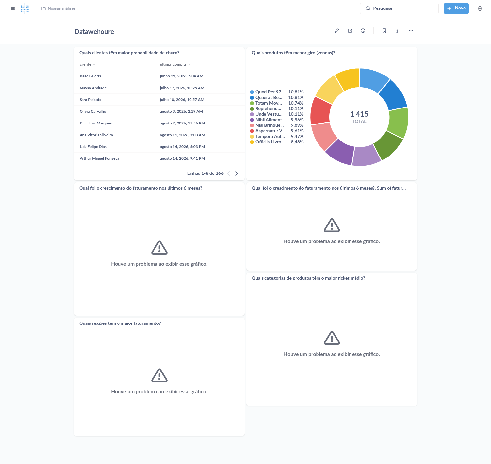

Quatro dos seis gráficos mostram **"Houve um problema ao exibir esse
gráfico"**. Na etapa 5 eles funcionavam. O que mudou foi o modelo: você
removeu a coluna `total` da `fato_pedidos`, e é ela que esses gráficos somam.

Isso é esperado, e é uma lição: **dashboard é dependente do modelo**. Quando o
modelo evolui, alguém precisa evoluir os painéis. Nesta etapa, esse alguém é
você.

Mas repare nos dois gráficos que **não** quebraram, e no dashboard
**Transacional**, que está inteiro. Quebrar é o problema fácil: todo mundo
vê. O difícil é o gráfico que continua funcionando com o número errado.

---

## 8.2 Avise o Metabase que o modelo mudou

O Metabase guarda uma cópia da lista de tabelas e colunas de cada banco. Você
criou 15 tabelas e dezenas de colunas desde que ele olhou pela última vez.
Peça para ele reler:

<!-- rodar: shell -->
```bash
make metabase-sync
```

```
  ✅ Liga Sudoers: 13 tabelas sincronizadas
  ✅ Liga DW:      11 tabelas sincronizadas
  O Metabase já enxerga as tabelas e colunas novas.
```

<details>
<summary>Como fazer o mesmo pela interface (clique para abrir)</summary>

1. Clique na **engrenagem** no canto superior direito → **Configurações de admin**.
2. No menu roxo do topo, clique em **Bancos de Dados**.
3. Clique em **Liga DW**.
4. À direita, clique em **Sincronize o esquema do banco de dados agora**.
5. Volte, abra **Liga Sudoers** e faça o mesmo.
6. Clique em **Sair do admin**, no canto superior direito.

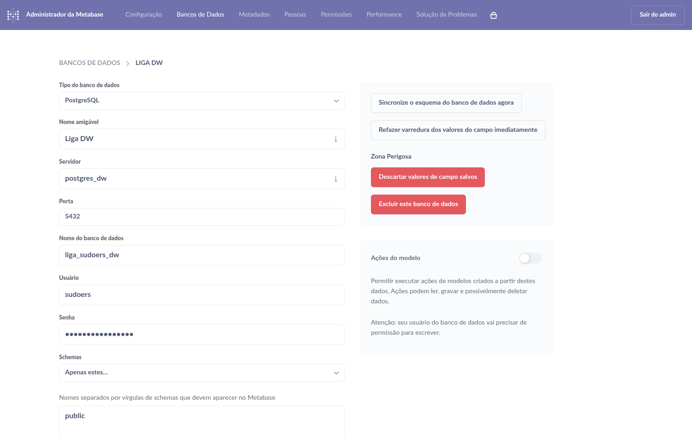

</details>

> **Guarde este passo.** "Criei a tabela e ela não aparece no Metabase" é a
> dúvida mais comum de quem começa. A resposta é sempre sincronizar.

---

## 8.3 A sua lista de tarefas

<!-- rodar: shell falha-esperada -->
```bash
make conferir-dashboards
```

O comando roda **todos** os gráficos de todos os dashboards e resume:

```
Datawehoure  (6 gráficos)
  ✅ Quais clientes têm maior probabilidade de churn? (303 linhas)
  ✅ Quais produtos têm menor giro (vendas)? (10 linhas)
  ❌ Qual foi o crescimento do faturamento nos últimos 6 meses?
  ❌ Qual foi o crescimento do faturamento nos últimos 6 meses?, Sum of faturamento_mensal, Grouped by mes: Semana
  ❌ Quais categorias de produtos têm o maior ticket médio?
  ❌ Quais regiões têm o maior faturamento?

Transacional  (7 gráficos)
  ✅ Novas pessoas últimos 7 dias (1 linhas)
  ✅ Total de produtos por categoria (12 linhas)
  ✅ Pedidos por data da venda (7 linhas)
  ✅ Qtde vendas nos últimos 7 dias (1 linhas)
  ✅ Total de vendas por dia (7 linhas)
  ✅ Total de produtos vendidos no últimos 7 dias (193 linhas)
  ✅ Ticket médio dos últimos 7 dias. (1 linhas)

❌ Dashboards incompletos. O que falta:

   • Qual foi o crescimento do faturamento nos últimos 6 meses?
       está quebrado: ERROR: column "total" does not exist
   • Qual foi o crescimento do faturamento nos últimos 6 meses?, Sum of faturamento_mensal, Grouped by mes: Semana
       está quebrado: ERROR: column "total" does not exist
   • Quais categorias de produtos têm o maior ticket médio?
       está quebrado: ERROR: column fp.total does not exist
   • Quais regiões têm o maior faturamento?
       está quebrado: ERROR: column "total" does not exist
   • Pedidos por data da venda
       ainda pega os 7 PRIMEIROS dias e conta pedidos cancelados
   • Total de produtos vendidos no últimos 7 dias
       ainda soma o preço de catálogo (valor_unit) e ignora a quantidade
   • Total vendido no últimos 7 dias
       ainda agrupa por produto: o "ticket médio" sai errado
   • Quais clientes têm maior probabilidade de churn?
       ainda agrupa por nome e ignora a versão atual da pessoa (SCD 2)
   • Quais categorias de produtos têm o maior ticket médio?
       ainda liga a fato na dimensão pelo id em vez da sk_produto
   • Datawehoure
       renomeie para "Data Warehouse"
   • Antifraude
       ainda não foi criado
   • Logística
       ainda não foi criado
   • Ciclo do pedido
       ainda não foi criado
   • Transacional
       falta o gráfico novo "Pedidos por situação nos últimos 7 dias"

   14 pendência(s). Passo a passo: dashboard/README.md
```

Leia a lista em três grupos:

| Grupo | Quantos | O que é |
|---|---|---|
| **está quebrado** | 4 | Gráficos do DW que dão erro |
| **ainda...** | 5 | Gráficos que **funcionam** e mostram número errado. O comando reconhece o erro lendo o SQL de cada um |
| **renomeie / não foi criado / falta** | 5 | O que precisa nascer |

---

## 8.4 A receita para consertar um gráfico

Você vai repetir estes cinco passos em cada conserto.

**1. Abra o gráfico.** Use o link direto que este roteiro dá em cada conserto
(ou, no dashboard, clique no **título** do gráfico).

**2. Clique em ABRIR EDITOR**, à direita da faixa "Esta pergunta está escrita
em SQL.".

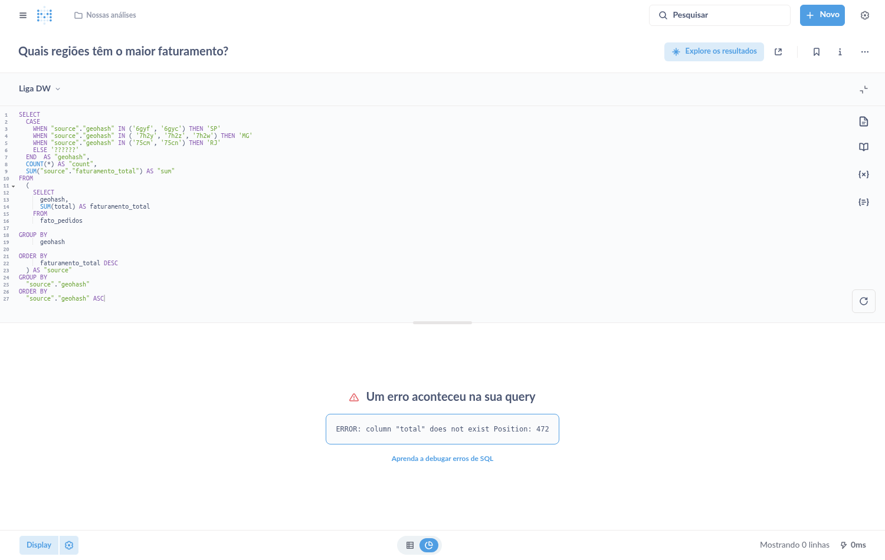

**3. Troque o SQL.** Clique dentro do editor, selecione tudo (`Ctrl+A`),
apague e cole o SQL novo.

**4. Execute.** Aperte `Ctrl+Enter` (ou clique no botão azul ▶, no canto
inferior direito do editor). O gráfico reaparece embaixo.

**5. Salve.** Clique em **Salvar**, no canto superior direito. Na janela,
deixe marcado **Substituir a pergunta original** e clique em **Salvar**.

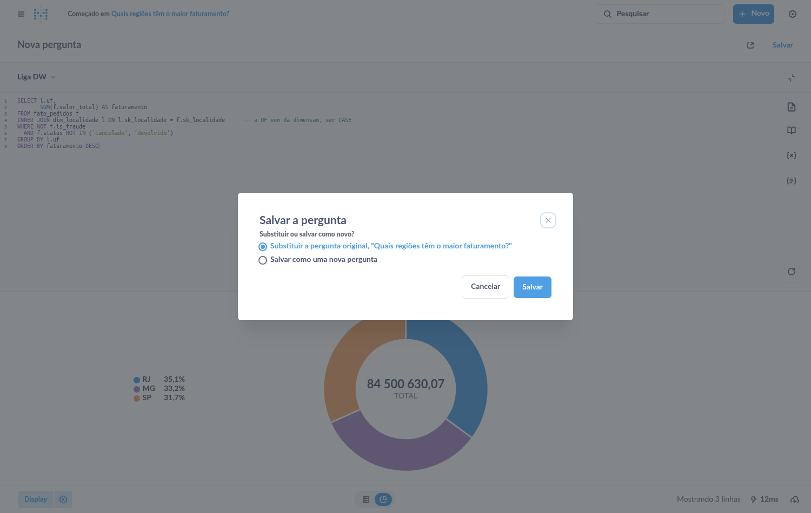

> Escolha sempre **Substituir**. Se você salvar como pergunta nova, o
> dashboard continua apontando para a antiga.

---

## 8.5 Consertar o dashboard do DW

### Conserto 1 — O nome do dashboard

1. Abra o dashboard **Datawehoure**.
2. Clique no **lápis** (Editar dashboard), no alto à direita.
3. Clique em cima do título, apague, escreva **Data Warehouse** e aperte
   `Enter`.
4. Clique em **Salvar**, na faixa azul do topo.

### Conserto 2 — Crescimento do faturamento

Abra: **http://localhost:3020/question/50**

O SQL antigo:

```sql
SELECT DATE_TRUNC('month', dt_venda) AS mes,
       SUM(total) AS faturamento_mensal
FROM fato_pedidos
WHERE dt_venda >= CURRENT_DATE - INTERVAL '6 months'
GROUP BY DATE_TRUNC('month', dt_venda)
ORDER BY mes;
```

**O erro de modelagem:** `SUM(total)`. É o faturamento em dobro da etapa 5 — a
medida do pedido somada no grão do item. Agora, além de errado, dá erro: a
coluna não existe mais.

O SQL novo:

<!-- rodar: dw -->
```sql
SELECT DATE_TRUNC('month', dt_venda) AS mes,
       SUM(valor_total)              AS faturamento_mensal            -- valor do ITEM: nao conta em dobro
FROM fato_pedidos
WHERE dt_venda >= CURRENT_DATE - INTERVAL '6 months'
  AND NOT is_fraude                                                   -- fraude nao e faturamento
  AND status NOT IN ('cancelado', 'devolvido')
GROUP BY DATE_TRUNC('month', dt_venda)
ORDER BY mes
```

**O que mudou, e qual conceito está por trás:**

| Mudança | Conceito |
|---|---|
| `SUM(total)` → `SUM(valor_total)` | **Grão**: a medida agora é do item, igual à fato |
| `AND NOT is_fraude` | Coluna nova da Demanda 1: fraude não é faturamento |
| `AND status NOT IN (...)` | Coluna nova da Demanda 3: pedido cancelado ou devolvido não é faturamento |

Depois de salvar, abra o dashboard: **dois** gráficos voltaram. O gráfico de
linha ao lado é construído **em cima** deste, então foi consertado de carona.
Compare o número grande com o da etapa 5: era cerca de quatro vezes maior.

### Conserto 3 — Ticket médio por categoria

Abra: **http://localhost:3020/question/52**

(Este não está no dashboard: é a tabela que alimenta a pizza "Quais
categorias de produtos têm o maior ticket médio?".)

O SQL antigo:

```sql
SELECT dp.cat_desc AS categoria,
       AVG(fp.total) AS ticket_medio
FROM fato_pedidos fp
INNER JOIN dim_produtos dp ON fp.sk_produto = dp.id
GROUP BY dp.cat_desc
ORDER BY ticket_medio DESC;
```

**Há dois erros de modelagem aqui, e um deles nunca deu erro:**

1. `AVG(fp.total)` — de novo a medida no grão errado.
2. `ON fp.sk_produto = dp.id` — liga a **chave substituta** da fato com o
   **id do transacional** da dimensão. São duas numerações diferentes. Na
   etapa 5 você viu o produto de `id = 1` ganhar uma segunda linha, com
   `sk_produto = 201`. Para este gráfico, as vendas ligadas à `sk` 201 seriam
   do produto de `id = 201` — que nem existe: elas sumiam do relatório, sem
   erro nenhum. O `JOIN` só "funcionava" enquanto as duas numerações
   coincidiam por acaso.

O SQL novo:

<!-- rodar: dw -->
```sql
SELECT dp.cat_desc AS categoria,
       ROUND(SUM(fp.valor_total) / COUNT(DISTINCT fp.id_pedido), 2) AS ticket_medio
FROM fato_pedidos fp
INNER JOIN dim_produtos dp ON fp.sk_produto = dp.sk_produto           -- sk com sk (antes: sk com id!)
WHERE NOT fp.is_fraude
  AND fp.status NOT IN ('cancelado', 'devolvido')
GROUP BY dp.cat_desc
ORDER BY ticket_medio DESC
```

| Mudança | Conceito |
|---|---|
| `dp.id` → `dp.sk_produto` | **Chave substituta**: fato e dimensão se ligam pela `sk_`, sempre |
| `AVG(total)` → `SUM(valor_total) / COUNT(DISTINCT id_pedido)` | Ticket médio é valor **por pedido**. A fato está no grão do item, então a conta divide pelo número de pedidos |

Salve e volte ao dashboard: a pizza de categorias reapareceu.

### Conserto 4 — Regiões com maior faturamento

Abra: **http://localhost:3020/question/55**

O SQL antigo (resumido):

```sql
SELECT CASE WHEN geohash IN ('6gyf', '6gyc')         THEN 'SP'
            WHEN geohash IN ('7h2y', '7h2z', '7h2w') THEN 'MG'
            WHEN geohash IN ('75cm', '75cn')         THEN 'RJ'
            ELSE '??????'
       END AS geohash,
       COUNT(*), SUM(faturamento_total)
FROM (SELECT geohash, SUM(total) AS faturamento_total FROM fato_pedidos GROUP BY geohash) ...
```

**O erro de modelagem:** a regra "qual geohash é qual estado" escrita dentro
do gráfico. É a pizza `??????` da etapa 5.

O SQL novo:

<!-- rodar: dw -->
```sql
SELECT l.uf,
       SUM(f.valor_total) AS faturamento
FROM fato_pedidos f
INNER JOIN dim_localidade l ON l.sk_localidade = f.sk_localidade      -- a UF vem da dimensao, sem CASE
WHERE NOT f.is_fraude
  AND f.status NOT IN ('cancelado', 'devolvido')
GROUP BY l.uf
ORDER BY faturamento DESC
```

| Mudança | Conceito |
|---|---|
| O `CASE` desapareceu | **Regra de negócio no modelo**: a UF vem pronta de `dim_localidade` |
| 20 linhas viraram 8 | É para isso que serve uma dimensão |

Ao executar, a pizza se redesenha sozinha com três fatias: RJ, MG e SP.

> Existe uma segunda versão deste gráfico, em formato de tabela, que não está
> em nenhum dashboard: http://localhost:3020/question/54. O mesmo SQL
> conserta. É opcional.

### Conserto 5 — Clientes com probabilidade de churn

Abra: **http://localhost:3020/question/48**

Este **não quebrou**. O SQL antigo:

```sql
SELECT dp.nome AS cliente,
       MAX(fp.dt_venda) AS ultima_compra
FROM fato_pedidos fp
INNER JOIN dim_pessoas dp ON fp.sk_pessoa = dp.sk_pessoa
GROUP BY dp.nome
HAVING MAX(fp.dt_venda) < CURRENT_DATE - INTERVAL '7 days'
ORDER BY ultima_compra;
```

**O problema de modelagem:** `GROUP BY dp.nome`. Dois clientes com o mesmo
nome viram uma pessoa só. E agora que `dim_pessoas` é SCD tipo 2, uma pessoa
tem várias linhas — qual cidade mostrar?

O SQL novo:

<!-- rodar: dw -->
```sql
SELECT atual.nome        AS cliente,
       atual.cidade,
       atual.uf,
       MAX(fp.dt_venda)  AS ultima_compra
FROM fato_pedidos fp
INNER JOIN dim_pessoas dp    ON dp.sk_pessoa = fp.sk_pessoa
INNER JOIN dim_pessoas atual ON atual.id = dp.id AND atual.is_atual   -- a versao ATUAL da mesma pessoa
GROUP BY atual.id, atual.nome, atual.cidade, atual.uf                 -- por id: homonimos nao se misturam
HAVING MAX(fp.dt_venda) < CURRENT_DATE - INTERVAL '7 days'
ORDER BY ultima_compra
```

| Mudança | Conceito |
|---|---|
| Segundo `JOIN` em `dim_pessoas`, com `is_atual` | **SCD tipo 2**: as vendas apontam para a versão da época; para mostrar onde a pessoa mora **hoje**, busca-se a versão atual do mesmo `id` |
| `GROUP BY atual.id, ...` | Agrupar pela chave de negócio, não pelo nome |

A tabela ganha as colunas de cidade e UF: agora dá para ligar para o cliente
certo.

### ✔️ Confira

Abra o dashboard **Data Warehouse**: os seis gráficos funcionam.

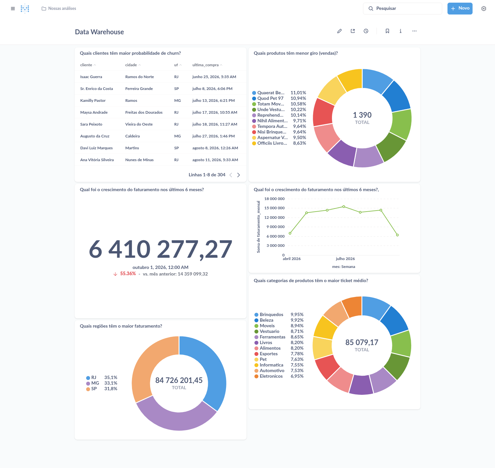

Compare a pizza de regiões (três fatias, no lugar de `??????`) e o
faturamento (agora o valor real).

---

## 8.6 Consertar o dashboard Transacional

Este dashboard lê o banco transacional, e nenhum gráfico dele quebrou — as 6
tabelas antigas continuam lá. Mas três estão errados, e você tem como provar:
lembra dos dois números que anotou na etapa 4?

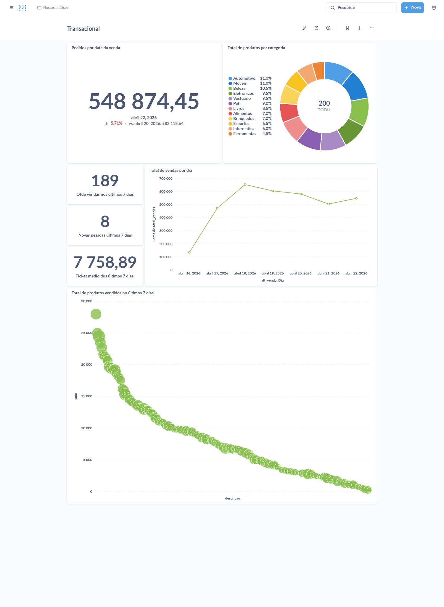

### Conserto 6 — Pedidos por data da venda

Abra: **http://localhost:3020/question/40**

O SQL antigo:

```sql
SELECT cast(dt_venda as date) as dt_venda, count(*) qtde_vendas, sum(valor_total) total_vendas
FROM pedidos
group by 1 order by 1 limit 7
```

**O erro:** `order by 1 limit 7` devolve os **sete primeiros dias da
história**, não os últimos. Olhe o gráfico "Total de vendas por dia": as datas
são de seis meses atrás. O card "Qtde vendas nos últimos 7 dias" soma esses
sete dias — é um número de abril com um título de hoje. Enquanto a tabela
tinha uma semana de dados, ninguém notou.

O SQL novo:

<!-- rodar: oltp -->
```sql
SELECT cast(dt_venda AS date) AS dt_venda,
       count(*)               AS qtde_vendas,
       sum(valor_total)       AS total_vendas
FROM pedidos
WHERE dt_venda >= current_date - 6                   -- os ULTIMOS 7 dias
  AND status NOT IN ('cancelado', 'devolvido')       -- campo novo: venda cancelada nao e venda
GROUP BY 1
ORDER BY 1
```

| Mudança | Conceito |
|---|---|
| `limit 7` → `WHERE dt_venda >= current_date - 6` | Filtrar pelo período, e não pela posição da linha |
| `AND status NOT IN (...)` | A coluna `pedidos.status`, que você criou na etapa 3, já melhora um relatório operacional |

Depois de salvar, **três** gráficos mudam: este, "Qtde vendas nos últimos 7
dias" e "Total de vendas por dia", que são construídos em cima dele. Compare a
quantidade de vendas com a que você anotou.

### Conserto 7 — Produtos vendidos nos últimos 7 dias

Abra: **http://localhost:3020/question/44**

O SQL antigo (resumido):

```sql
SELECT descricao, count(*), sum(valor_unit)
FROM pedidos ped
INNER JOIN itens_pedidos ip ON ip.id_pedido = ped.id
INNER JOIN produtos p ON p.id = ip.id_produto
WHERE ped.dt_venda >= now() - interval '7 days'
GROUP BY 1 ORDER BY 3 desc
```

**O erro:** `sum(valor_unit)` soma o **preço de catálogo** do produto, uma vez
por linha, **ignorando a quantidade**. Quem comprou 4 unidades conta como 1.
E `valor_unit` é o preço de **hoje**, não o da venda.

O SQL novo:

<!-- rodar: oltp -->
```sql
SELECT p.descricao,
       sum(ip.qtde)        AS count,                 -- unidades vendidas
       sum(ip.valor_total) AS sum                    -- valor vendido (quantidade x preco)
FROM pedidos ped
INNER JOIN itens_pedidos ip ON ip.id_pedido = ped.id
INNER JOIN produtos p ON p.id = ip.id_produto
WHERE ped.dt_venda >= now() - interval '7 days'
  AND ped.status NOT IN ('cancelado', 'devolvido')
GROUP BY 1
ORDER BY 3 DESC
```

| Mudança | Conceito |
|---|---|
| `sum(valor_unit)` → `sum(ip.valor_total)` | O valor da venda está no **item**, não no cadastro do produto |
| `count(*)` → `sum(ip.qtde)` | Contar linhas não é contar unidades |

### Conserto 8 — O ticket médio

Abra: **http://localhost:3020/question/45**

(Este também não está no dashboard: é a tabela que alimenta o card "Ticket
médio dos últimos 7 dias".)

O SQL antigo (resumido):

```sql
SELECT descricao, sum(valor_unit)
FROM pedidos ped ... INNER JOIN produtos p ...
GROUP BY 1
```

**O erro:** a tabela agrupa por **produto**, e o card tira a média dela. O
resultado é "a média do valor vendido por produto", com o rótulo de ticket
médio. Ticket médio é o valor médio **por pedido**.

O SQL novo:

<!-- rodar: oltp -->
```sql
SELECT id          AS pedido,
       valor_total AS sum                            -- uma linha por PEDIDO: a media disto e o ticket medio
FROM pedidos
WHERE dt_venda >= now() - interval '7 days'
  AND status NOT IN ('cancelado', 'devolvido')
ORDER BY 2 DESC
```

Depois de salvar, aproveite e renomeie: clique no título, no alto da página,
troque para **Valor por pedido nos últimos 7 dias** e aperte `Enter`.

Abra o dashboard e compare o **ticket médio** com o que você anotou na etapa
4. É outro número — e agora é o certo.

> É o mesmo erro de **grão** da `fato_pedidos`, num lugar onde ninguém
> esperava: uma média tirada no grão errado.

---

## 8.7 A receita para criar um gráfico

Agora o que não existia. Você vai repetir estes passos para cada gráfico novo.

**1.** Clique em **+ Novo** (canto superior direito) → **Consulta SQL**.

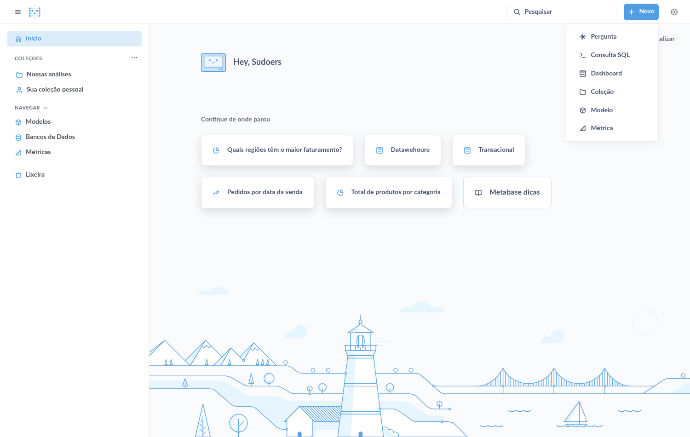

**2. Confira o banco**, no canto superior esquerdo do editor. Para os
gráficos do DW tem que estar **Liga DW**; para os do transacional, **Liga
Sudoers**. Clique no nome para trocar.

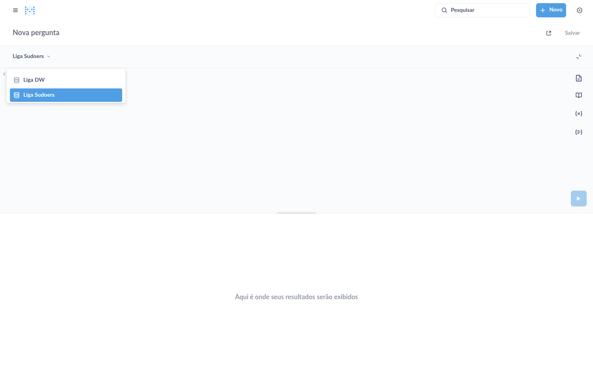

> ⚠️ O Metabase abre o editor no **último banco que você usou**. Este é o
> erro mais comum da etapa: colar um SQL do DW com o editor apontando para o
> transacional. Se aparecer `relation "..." does not exist`, é isso.

**3.** Cole o SQL e execute (`Ctrl+Enter`). O resultado aparece como tabela.

**4. Escolha o tipo de gráfico.** Clique em **Display**, no canto inferior
esquerdo, clique no tipo indicado na ficha e depois em **Feito**.

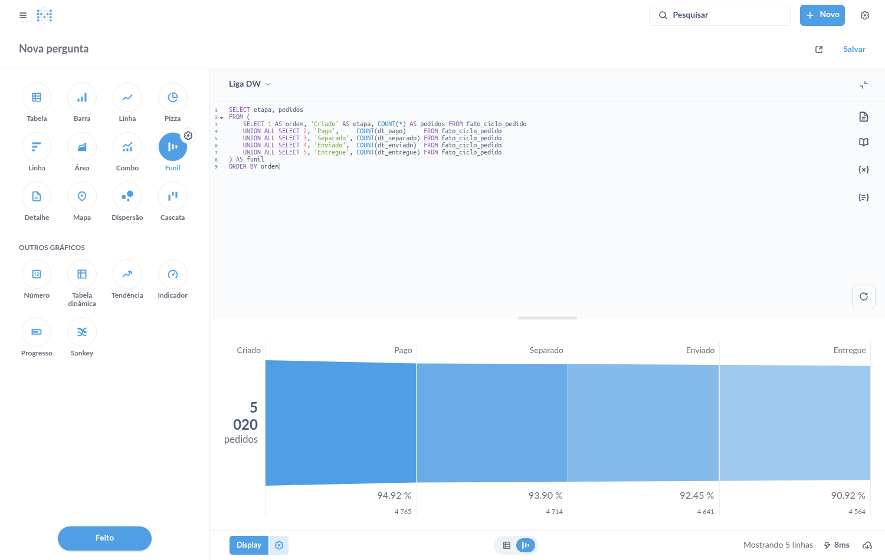

> Há dois ícones chamados **Linha**. O de cima (uma linha ondulada) é o
> gráfico de linha, e é o que este roteiro usa. O de baixo é o de barras
> horizontais.

**5. Salve.** Clique em **Salvar** (canto superior direito), preencha o
**Nome** exatamente como está na ficha e clique em **Salvar**.

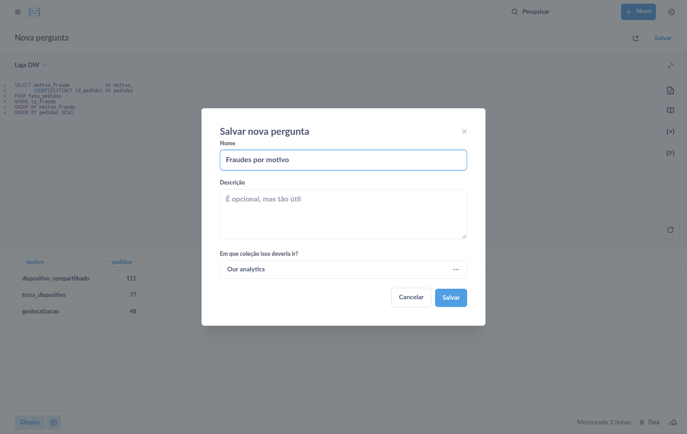

**6.** O Metabase pergunta **"Salvo! Adicionar isto a um dashboard?"**.
Responda **Agora não**: você vai montar o dashboard depois, com todos os
gráficos de uma vez.

### E a receita para montar um dashboard

**1.** Clique em **+ Novo** → **Dashboard**. Dê o **Nome** e clique em
**Criar**.

**2.** O dashboard abre vazio, já em modo de edição. Clique em **Adicionar uma
pergunta salva** (ou no botão **+** da barra).

**3.** Na lista à direita, clique em cada gráfico que você criou. Ele entra no
dashboard.

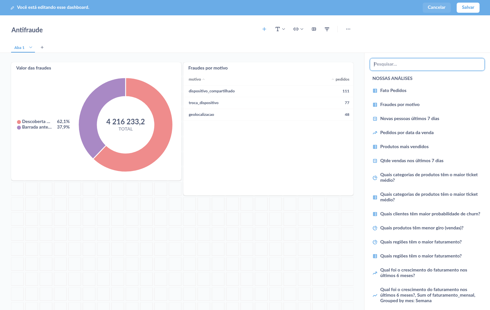

**4.** Arraste para arrumar e puxe o canto inferior direito de cada gráfico
para mudar o tamanho.

**5.** Clique em **Salvar**, na faixa azul do topo.

---

## 8.8 Um gráfico novo no Transacional

Antes dos dashboards novos, um aquecimento. A coluna `pedidos.status` permite
algo que o dashboard operacional nunca teve: ver a situação dos pedidos.

| | |
|---|---|
| **Nome** | `Pedidos por situação nos últimos 7 dias` |
| **Banco** | Liga Sudoers |
| **Display** | Barra |

<!-- rodar: oltp -->
```sql
SELECT status   AS situacao,
       count(*) AS pedidos
FROM pedidos
WHERE dt_venda >= now() - interval '7 days'
GROUP BY 1
ORDER BY 2 DESC
```

Neste, quando o Metabase perguntar **"Adicionar isto a um dashboard?"**,
responda **Sim, por favor!**, escolha **Transacional**, clique em
**Selecionar** e depois em **Salvar** na faixa azul.

---

## 8.9 Dashboard novo: Antifraude (Demanda 1)

Crie os seis gráficos (banco **Liga DW** em todos) e depois o dashboard
**Antifraude**.

### Gráfico 1

| | |
|---|---|
| **Nome** | `Taxa de fraude (%)` |
| **Display** | Número |
| **Responde** | De cada 100 pedidos, quantos são fraude? |

<!-- rodar: dw -->
```sql
SELECT ROUND(100.0 * COUNT(*) FILTER (WHERE is_fraude) / COUNT(*), 2) AS taxa_fraude_pct
FROM fato_ciclo_pedido
```

Lê a `fato_ciclo_pedido` porque ela tem **uma linha por pedido**: contar
linhas é contar pedidos. Na `fato_pedidos` (uma linha por item) a mesma conta
precisaria de `COUNT(DISTINCT id_pedido)`. Escolher a fato pelo grão certo
simplifica a consulta.

### Gráfico 2

| | |
|---|---|
| **Nome** | `Fraudes por motivo` |
| **Display** | Pizza |
| **Responde** | Qual tipo de fraude é mais comum? |

<!-- rodar: dw -->
```sql
SELECT motivo_fraude             AS motivo,
       COUNT(DISTINCT id_pedido) AS pedidos
FROM fato_pedidos
WHERE is_fraude
GROUP BY motivo_fraude
ORDER BY pedidos DESC
```

### Gráfico 3

| | |
|---|---|
| **Nome** | `Valor das fraudes: barradas x descobertas tarde` |
| **Display** | Pizza |
| **Responde** | Quanto da fraude foi barrado antes de o pedido sair? |

<!-- rodar: dw -->
```sql
SELECT CASE WHEN dt_enviado IS NULL THEN 'Barrada antes do envio'
            ELSE 'Descoberta depois do envio'
       END              AS desfecho,
       SUM(valor_total) AS valor
FROM fato_ciclo_pedido
WHERE is_fraude
GROUP BY 1
ORDER BY 1
```

Só o **snapshot acumulado** responde isto com tanta facilidade: se
`dt_enviado` está nula, o pedido nunca saiu do galpão. Fraude descoberta
depois do envio é prejuízo.

### Gráfico 4

| | |
|---|---|
| **Nome** | `Pedidos de fora da área atendida, por UF` |
| **Display** | Barra |
| **Responde** | De onde vêm as compras suspeitas? |

<!-- rodar: dw -->
```sql
SELECT l.nome_uf                   AS uf,
       COUNT(DISTINCT f.id_pedido) AS pedidos
FROM fato_pedidos f
INNER JOIN dim_localidade l ON l.sk_localidade = f.sk_localidade
WHERE NOT l.is_area_atendida
GROUP BY l.nome_uf
ORDER BY pedidos DESC
```

`WHERE NOT l.is_area_atendida`: a regra de negócio, lida da dimensão.

### Gráfico 5

| | |
|---|---|
| **Nome** | `Taxa de fraude por forma de pagamento (%)` |
| **Display** | Barra |
| **Responde** | Por qual meio de pagamento a fraude entra? |

<!-- rodar: dw -->
```sql
SELECT p.descricao AS forma_pagamento,
       ROUND(100.0 * COUNT(DISTINCT f.id_pedido) FILTER (WHERE f.is_fraude)
             / COUNT(DISTINCT f.id_pedido), 2) AS taxa_fraude_pct
FROM fato_pedidos f
INNER JOIN dim_forma_pagamento p ON p.sk_forma_pagamento = f.sk_forma_pagamento
GROUP BY p.descricao
ORDER BY taxa_fraude_pct DESC
```

### Gráfico 6

| | |
|---|---|
| **Nome** | `Aparelhos compartilhados (suspeita de anel de fraude)` |
| **Display** | Tabela |
| **Responde** | Quais aparelhos são usados por várias contas? |

<!-- rodar: dw -->
```sql
SELECT d.device_id,
       d.modelo,
       d.fabricante,
       d.qtd_contas,
       COUNT(DISTINCT f.id_pedido) AS pedidos,
       SUM(f.valor_total)          AS valor_sob_suspeita
FROM dim_dispositivo d
INNER JOIN fato_pedidos f ON f.sk_dispositivo = d.sk_dispositivo
WHERE d.is_compartilhado
GROUP BY d.device_id, d.modelo, d.fabricante, d.qtd_contas
ORDER BY valor_sob_suspeita DESC
```

São os seis anéis de fraude. Na etapa 4 esta pergunta precisou de três
tabelas e um `HAVING`. Aqui é `WHERE d.is_compartilhado`.

### Monte o dashboard

**+ Novo → Dashboard** → nome **Antifraude** → adicione os seis gráficos →
**Salvar**.

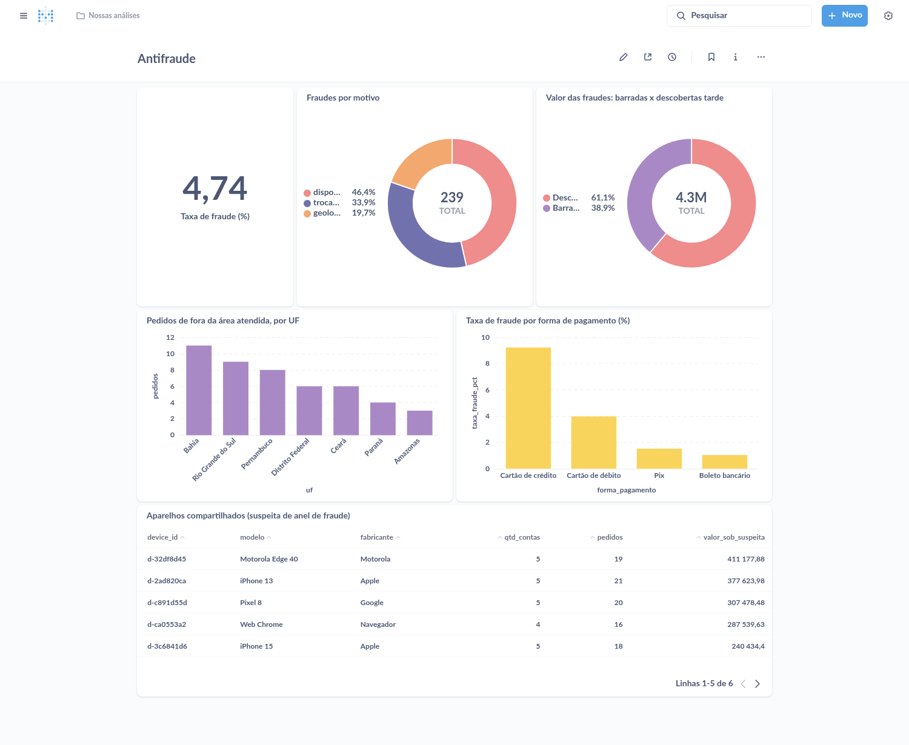

---

## 8.10 Dashboard novo: Logística (Demanda 2)

Cinco gráficos, banco **Liga DW**, dashboard **Logística**.

### Gráfico 1

| | |
|---|---|
| **Nome** | `Pedidos em trânsito agora` |
| **Display** | Número |

<!-- rodar: dw -->
```sql
SELECT COUNT(*) AS pedidos_em_transito
FROM fato_entregas
WHERE NOT is_entregue
```

### Gráfico 2

| | |
|---|---|
| **Nome** | `Peso médio por pedido, por dia (kg)` |
| **Display** | Linha |
| **Responde** | O pedido literal da diretoria: o histórico diário do peso |

<!-- rodar: dw -->
```sql
SELECT t.data,
       ROUND(SUM(d.peso_total_gramas) / 1000.0 / SUM(d.qtd_pedidos), 2) AS peso_medio_kg
FROM fato_peso_diario d
INNER JOIN dim_tempo t ON t.sk_tempo = d.sk_tempo
WHERE t.data >= CURRENT_DATE - 60
GROUP BY t.data
ORDER BY t.data
```

Lê o **snapshot periódico**. A média é calculada na hora, a partir do peso
total e da quantidade de pedidos.

### Gráfico 3

| | |
|---|---|
| **Nome** | `Entregas atrasadas por transportadora (%)` |
| **Display** | Barra |
| **Responde** | Quem atrasa? |

<!-- rodar: dw -->
```sql
SELECT t.nome AS transportadora,
       ROUND(100.0 * COUNT(*) FILTER (WHERE f.is_atrasada) / COUNT(*), 1) AS pct_atrasadas
FROM fato_entregas f
INNER JOIN dim_transportadora t ON t.sk_transportadora = f.sk_transportadora
GROUP BY t.nome
ORDER BY pct_atrasadas DESC
```

### Gráfico 4

| | |
|---|---|
| **Nome** | `Frete pago por mês, por transportadora` |
| **Display** | Barra, **empilhada** |
| **Responde** | Para quem vai o dinheiro do frete? |

<!-- rodar: dw -->
```sql
SELECT TO_CHAR(tp.data, 'YYYY-MM') AS mes,
       t.nome                      AS transportadora,
       SUM(d.valor_frete_total)    AS frete
FROM fato_peso_diario d
INNER JOIN dim_tempo tp         ON tp.sk_tempo = d.sk_tempo
INNER JOIN dim_transportadora t ON t.sk_transportadora = d.sk_transportadora
GROUP BY 1, 2
ORDER BY 1, 2
```

Este tem um ajuste a mais. Depois de escolher **Barra**, clique na
**engrenagem** ao lado do botão Display, abra a aba **Exibição** e, em
**Empilhado**, escolha **Pilha**. Clique em **Feito**.

### Gráfico 5

| | |
|---|---|
| **Nome** | `Custo e pontualidade por transportadora` |
| **Display** | Tabela |
| **Responde** | Vale a pena pagar menos por quilo? |

<!-- rodar: dw -->
```sql
SELECT t.nome                                                           AS transportadora,
       t.custo_por_kg,
       COUNT(*)                                                         AS entregas,
       ROUND(100.0 * COUNT(*) FILTER (WHERE f.is_atrasada) / COUNT(*), 1) AS pct_atrasadas,
       ROUND(AVG(f.dias_transito), 1)                                   AS media_dias_transito,
       SUM(f.valor_frete)                                               AS frete_pago
FROM fato_entregas f
INNER JOIN dim_transportadora t ON t.sk_transportadora = f.sk_transportadora
GROUP BY t.nome, t.custo_por_kg
ORDER BY t.custo_por_kg
```

Leia a tabela com calma: é a informação que a logística precisava para
negociar. A transportadora mais barata é a que mais atrasa.

### Monte o dashboard

**+ Novo → Dashboard** → nome **Logística** → adicione os cinco gráficos →
**Salvar**.

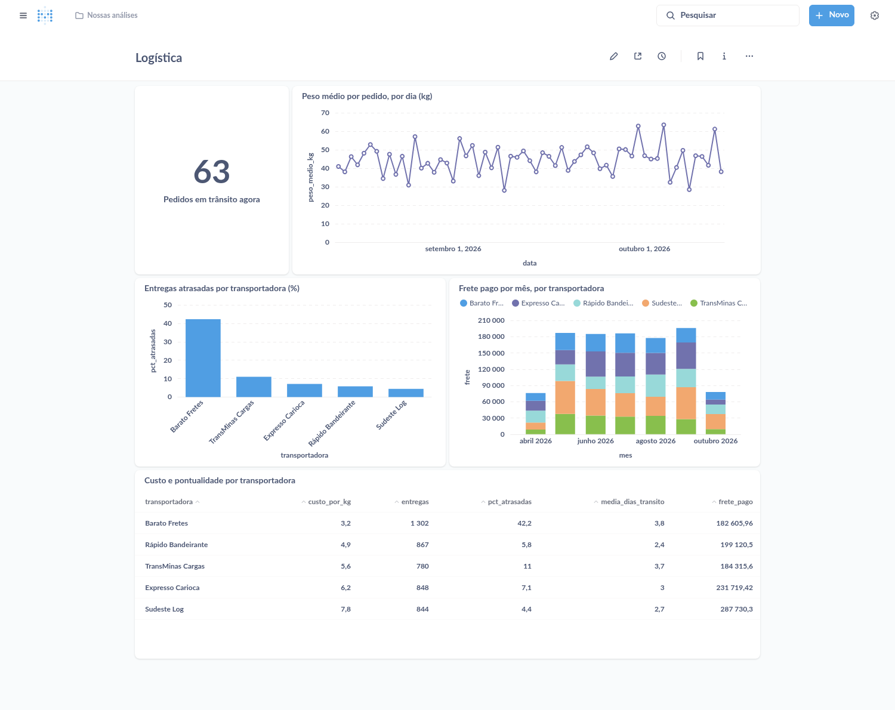

---

## 8.11 Dashboard novo: Ciclo do pedido (Demanda 3)

Cinco gráficos, banco **Liga DW**, dashboard **Ciclo do pedido**. Todos leem a
`fato_ciclo_pedido`.

### Gráfico 1

| | |
|---|---|
| **Nome** | `Funil do pedido` |
| **Display** | Funil |
| **Responde** | Quantos pedidos chegam a cada etapa? |

<!-- rodar: dw -->
```sql
SELECT etapa, pedidos
FROM (
    SELECT 1 AS ordem, 'Criado' AS etapa, COUNT(*) AS pedidos FROM fato_ciclo_pedido
    UNION ALL SELECT 2, 'Pago',     COUNT(dt_pago)     FROM fato_ciclo_pedido
    UNION ALL SELECT 3, 'Separado', COUNT(dt_separado) FROM fato_ciclo_pedido
    UNION ALL SELECT 4, 'Enviado',  COUNT(dt_enviado)  FROM fato_ciclo_pedido
    UNION ALL SELECT 5, 'Entregue', COUNT(dt_entregue) FROM fato_ciclo_pedido
) AS funil
ORDER BY ordem
```

`COUNT(dt_pago)` conta só as linhas em que a data **não é nula**: quantos
pedidos já passaram por aquele marco. É o snapshot acumulado mostrando para
que serve.

### Gráfico 2

| | |
|---|---|
| **Nome** | `Tempo médio de cada etapa (horas)` |
| **Display** | Barra |
| **Responde** | Onde o pedido demora? |

<!-- rodar: dw -->
```sql
SELECT etapa, horas
FROM (
    SELECT 1 AS ordem, '1. Compra ate pagamento' AS etapa,
           ROUND(AVG(horas_ate_pagamento), 1) AS horas
    FROM fato_ciclo_pedido WHERE dt_entregue IS NOT NULL
    UNION ALL
    SELECT 2, '2. Pagamento ate envio',
           ROUND(AVG(horas_ate_envio - horas_ate_pagamento), 1)
    FROM fato_ciclo_pedido WHERE dt_entregue IS NOT NULL
    UNION ALL
    SELECT 3, '3. Envio ate entrega',
           ROUND(AVG(horas_ate_entrega - horas_ate_envio), 1)
    FROM fato_ciclo_pedido WHERE dt_entregue IS NOT NULL
) AS etapas
ORDER BY ordem
```

### Gráfico 3

| | |
|---|---|
| **Nome** | `Pedidos em aberto, por situação` |
| **Display** | Barra |
| **Responde** | O que está parado agora, e em qual fase? |

<!-- rodar: dw -->
```sql
SELECT status_atual AS situacao,
       COUNT(*)     AS pedidos
FROM fato_ciclo_pedido
WHERE status_atual NOT IN ('entregue', 'cancelado', 'devolvido')
GROUP BY status_atual
ORDER BY pedidos DESC
```

### Gráfico 4

| | |
|---|---|
| **Nome** | `Dias até a entrega, por semana da compra` |
| **Display** | Linha |
| **Responde** | O prazo de entrega está melhorando ou piorando? |

<!-- rodar: dw -->
```sql
SELECT DATE_TRUNC('week', dt_criado)::date    AS semana,
       ROUND(AVG(horas_ate_entrega) / 24, 2)  AS dias_ate_entrega
FROM fato_ciclo_pedido
WHERE dt_entregue IS NOT NULL
  AND dt_criado < CURRENT_DATE - 14           -- semanas ja "fechadas": as recentes ainda tem pedido na estrada
GROUP BY 1
ORDER BY 1
```

### Gráfico 5

| | |
|---|---|
| **Nome** | `Pedidos por dia da semana` |
| **Display** | Barra |
| **Responde** | Em que dia a operação precisa de mais gente? |

<!-- rodar: dw -->
```sql
SELECT nome_dia, pedidos
FROM (
    SELECT t.dia_semana, t.nome_dia, COUNT(*) AS pedidos
    FROM fato_ciclo_pedido f
    INNER JOIN dim_tempo t ON t.sk_tempo = f.sk_tempo_criado          -- dia da semana pronto, sem EXTRACT
    GROUP BY t.dia_semana, t.nome_dia
) AS dias
ORDER BY dia_semana
```

O nome do dia vem da `dim_tempo`. Sem ela, este gráfico pediria um
`EXTRACT(dow ...)` e um `CASE` com sete linhas.

### Monte o dashboard

**+ Novo → Dashboard** → nome **Ciclo do pedido** → adicione os cinco
gráficos → **Salvar**.

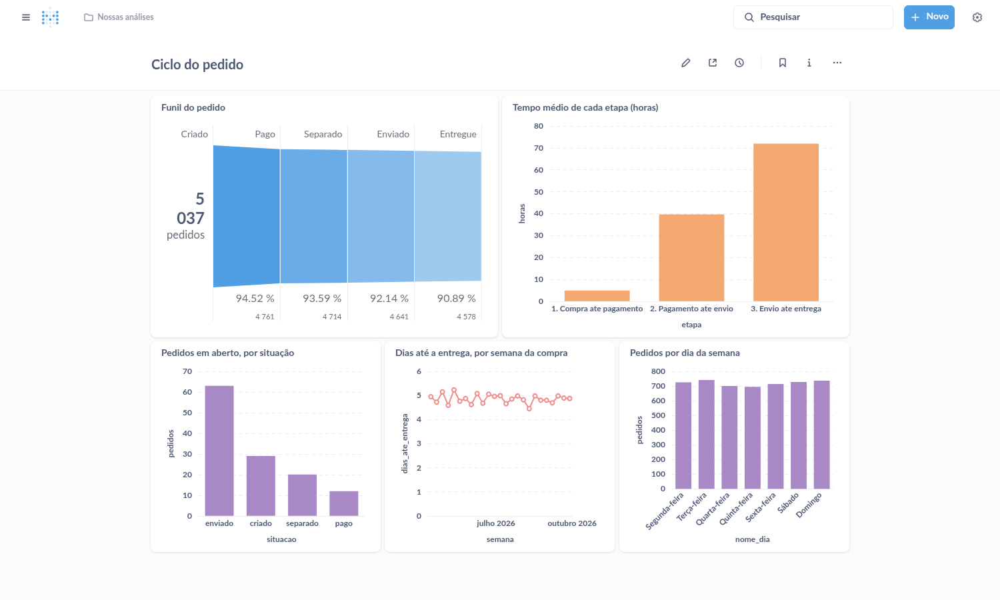

---

## 8.12 A prova

<!-- teste: make gabarito-dashboards -->
<!-- rodar: shell -->
```bash
make conferir-dashboards
```

```
Antifraude  (6 gráficos)
  ✅ Taxa de fraude (%) (1 linhas)
  ✅ Fraudes por motivo (3 linhas)
  ...
✅ Dashboards conferidos: 30 gráficos rodando, antigos consertados, 3 dashboards novos no ar.
```

Se ainda houver pendências, a lista diz qual gráfico e por quê.

> **Travou?** `make gabarito-dashboards` aplica todos os consertos e cria os
> três dashboards. Os SQLs são os mesmos deste roteiro e estão em
> [`dashboard/cards/`](./cards/).

---

## 8.13 Veja tudo se mexer

Se o streaming não estiver ligado, ligue:

```bash
make streaming-fundo
```

Abra o dashboard **Transacional**, clique no **relógio** (no alto, à direita)
e escolha **1 minuto**. O painel passa a se atualizar sozinho, e o gráfico de
situações muda conforme os pedidos entram.

Agora abra o **Ciclo do pedido**. Ele **não muda**. Rode:

```bash
make etl
```

Atualize a página: agora mudou.

Essa diferença é a última lição da disciplina. O dashboard transacional lê o
banco que está sendo gravado: é imediato, e disputa recurso com a operação. O
dashboard do DW lê uma **cópia transformada**, que só é tão recente quanto a
última carga. Em produção, alguém decide de quanto em quanto tempo o ETL roda
— uma vez por dia, de hora em hora, a cada minuto — e esse intervalo é uma
decisão de negócio, não de tecnologia.

Ao terminar: `make streaming-parar`.

---

## 🆘 Se algo deu errado

| O que apareceu | O que fazer |
|---|---|
| A tabela ou coluna nova não aparece no Metabase | `make metabase-sync` (seção 8.2) |
| `ERROR: relation "fato_ciclo_pedido" does not exist` ao executar | O gráfico está apontando para o banco errado. Troque para **Liga DW** no alto do editor |
| O gráfico continua quebrado no dashboard depois do conserto | Você salvou como pergunta **nova**. Abra o link direto de novo e, ao salvar, escolha **Substituir a pergunta original** |
| Não acho o botão **ABRIR EDITOR** | Você abriu um gráfico que não é escrito em SQL (os que são construídos em cima de outro). Use o link direto do roteiro |
| O gráfico de barras não empilhou | Engrenagem → aba **Exibição** → **Empilhado: Pilha** |
| A página do Metabase não abre | `make status`. Ele leva 1 a 2 minutos para subir. Se não subir: `make logs s=metabase` |
| Esqueci a senha ou troquei e perdi | `make limpar` apaga tudo e recomeça (você perde o progresso) |

Mais em [docs/faq.md](../docs/faq.md).

---

## ✅ Antes de seguir

* [ ] `make metabase-sync` rodou
* [ ] O dashboard se chama **Data Warehouse** e os seis gráficos funcionam
* [ ] A pizza de regiões mostra RJ, MG e SP
* [ ] O dashboard **Transacional** mostra os últimos 7 dias de verdade
* [ ] Criei **Antifraude**, **Logística** e **Ciclo do pedido**
* [ ] `make conferir-dashboards` mostra **✅ Dashboards conferidos**
* [ ] Sei dizer qual conceito de modelagem está por trás de cada conserto

Você terminou a trilha guiada. As três demandas estão respondidas, do banco
transacional até o gráfico.

---

# ➡️ Continue em [desafios/desafios.md](../desafios/desafios.md)
