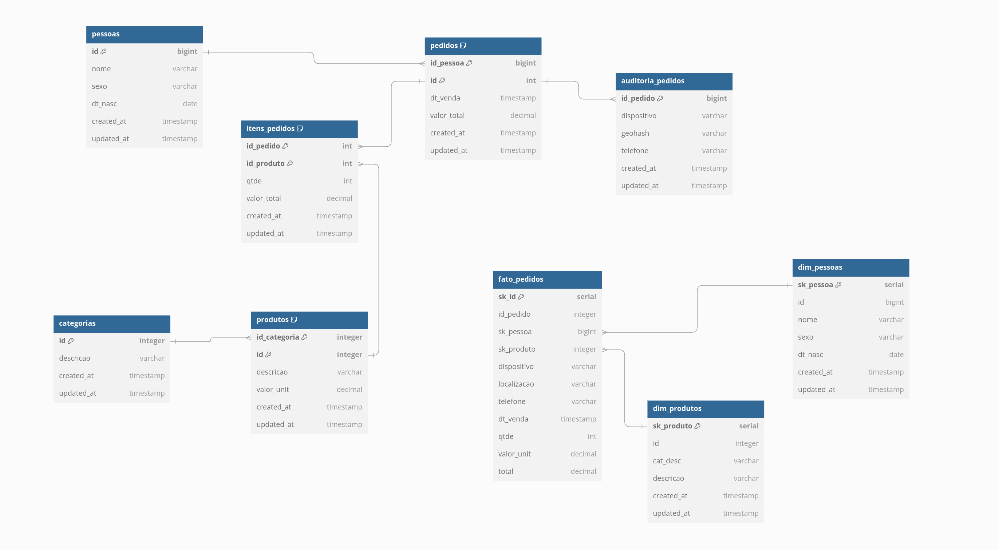

# 1️⃣ Conhecer o legado

> ⬅️ [README principal](../../README.md) · Etapa 1 de 9

Antes de mudar qualquer coisa, um bom modelador entende o que já existe. Nesta
etapa você **não altera nada**: só olha. O objetivo é sair daqui sabendo
dizer, com as suas palavras, o que a modelagem de hoje guarda — e o que ela
não tem como guardar.

---

## A empresa hoje

A Liga Sudoers tem dois bancos PostgreSQL, com dois desenhos diferentes para
os mesmos dados:



* À esquerda e acima, o **transacional (OLTP)**: 6 tabelas em 3ª forma
  normal. É onde o site grava cada pedido.
* À direita e abaixo, o **dimensional (DW)**: 1 fato e 2 dimensões. É de onde
  os dashboards leem.

Os mesmos modelos estão em texto, no formato do dbdiagram.io:
[`01_oltp_legado.dbml`](../dbml/01_oltp_legado.dbml) e
[`03_dw_legado.dbml`](../dbml/03_dw_legado.dbml).

> **Como ver um arquivo `.dbml` como diagrama:** abra
> [dbdiagram.io/d](https://dbdiagram.io/d), apague o exemplo que aparece à
> esquerda e cole o conteúdo do arquivo. O diagrama se desenha sozinho. Você
> vai usar isso a disciplina inteira.

---

## 1.1 O banco transacional

Abra o `psql` dentro do container do transacional:

```bash
make psql-oltp
```

Você verá o prompt `liga_sudoers=#`. Tudo que está nos blocos abaixo é para
colar ali. Para sair, digite `\q`.

**Liste as tabelas:**

<!-- rodar: oltp -->
```sql
\dt
```

```
              List of relations
 Schema |       Name        | Type  |  Owner
--------+-------------------+-------+---------
 public | auditoria_pedidos | table | sudoers
 public | categorias        | table | sudoers
 public | itens_pedidos     | table | sudoers
 public | pedidos           | table | sudoers
 public | pessoas           | table | sudoers
 public | produtos          | table | sudoers
(6 rows)
```

**Veja o que cada uma guarda:**

| Tabela | Uma linha é... | Ligada a |
|---|---|---|
| `pessoas` | um cliente | — |
| `categorias` | uma categoria de produto | — |
| `produtos` | um produto do catálogo | `categorias` |
| `pedidos` | uma compra | `pessoas` |
| `itens_pedidos` | um produto dentro de uma compra | `pedidos` e `produtos` |
| `auditoria_pedidos` | de onde e por qual aparelho a compra foi feita | `pedidos` |

**Conte o que já existe:**

<!-- rodar: oltp -->
```sql
SELECT (SELECT count(*) FROM categorias) AS categorias,
       (SELECT count(*) FROM produtos)   AS produtos,
       (SELECT count(*) FROM pessoas)    AS pessoas,
       (SELECT count(*) FROM pedidos)    AS pedidos;
```

```
 categorias | produtos | pessoas | pedidos
------------+----------+---------+---------
         12 |      200 |     500 |       0
(1 row)
```

> **Por que zero pedidos?** Neste laboratório o **cadastro** (categorias,
> produtos e pessoas) já vem carregado, e os **pedidos** são gerados por um
> simulador na etapa 4 — depois que você evoluir o modelo. Numa empresa de
> verdade essas tabelas já teriam milhões de linhas. Guarde essa ideia: na
> etapa 3 você vai tomar cuidados que só fazem sentido por causa dela.

**Conheça o primeiro cliente:**

<!-- rodar: oltp -->
```sql
SELECT id, nome, sexo, dt_nasc FROM pessoas ORDER BY id LIMIT 3;
```

```
 id |        nome        | sexo |  dt_nasc
----+--------------------+------+------------
  1 | Thomas Camargo     | M    | 1970-01-18
  2 | Sra. Luara Ribeiro | F    | 1999-03-17
  3 | Mateus Rocha       | M    | 1992-11-30
(3 rows)
```

> Os dados são gerados com uma **semente fixa**: todo aluno vê exatamente as
> mesmas pessoas e, mais adiante, os mesmos pedidos. É por isso que as saídas
> deste roteiro batem com as suas. (É também a mesma semente dos outros
> repositórios da Jornada: a pessoa 1 é o Thomas Camargo em todos eles.)

**Veja como produto e categoria estão separados:**

<!-- rodar: oltp -->
```sql
SELECT p.id, p.descricao, p.valor_unit, p.id_categoria, c.descricao AS categoria
FROM produtos p
JOIN categorias c ON c.id = p.id_categoria
ORDER BY p.id
LIMIT 3;
```

```
 id |      descricao       | valor_unit | id_categoria | categoria
----+----------------------+------------+--------------+------------
  1 | Tempore Automotivo 1 |     565.34 |           11 | Automotivo
  2 | Culpa Automotivo 2   |    3705.17 |           11 | Automotivo
  3 | Alias Alimento 3     |    1170.67 |            4 | Alimentos
(3 rows)
```

Repare que para mostrar o **nome** da categoria foi preciso um `JOIN`. O
produto guarda só o número (`id_categoria`). Isso é a **3ª forma normal**
funcionando: o texto "Automotivo" existe em um lugar só. Se a categoria mudar
de nome, muda em uma linha, e não em 200.

É ótimo para **gravar**. Você vai ver na etapa 5 por que é ruim para
**analisar**.

**Olhe com atenção a tabela de auditoria:**

<!-- rodar: oltp -->
```sql
\d auditoria_pedidos
```

```
                       Table "public.auditoria_pedidos"
   Column    |            Type             | Collation | Nullable | Default
-------------+-----------------------------+-----------+----------+---------
 id_pedido   | integer                     |           | not null |
 dispositivo | character varying(50)       |           | not null |
 geohash     | character varying(50)       |           | not null |
 telefone    | character varying(20)       |           | not null |
 created_at  | timestamp without time zone |           |          | now()
 updated_at  | timestamp without time zone |           |          | now()
Indexes:
    "auditoria_pedidos_pkey" PRIMARY KEY, btree (id_pedido)
Foreign-key constraints:
    "fk_auditoria_pedido" FOREIGN KEY (id_pedido) REFERENCES pedidos(id)
Triggers:
    set_updated_at_auditoria_pedidos BEFORE UPDATE ON auditoria_pedidos FOR EACH ROW EXECUTE FUNCTION update_updated_at_column()
```

Três coisas para notar, porque elas voltam nas próximas etapas:

1. **`dispositivo` é um texto.** "iPhone 15" escrito por extenso. Dois
   clientes com iPhone 15 têm o mesmo texto, e não há como saber se é o mesmo
   **aparelho físico**.
2. **`geohash` é um código de localização**, como `6gyf4bf`. Para saber o
   estado, alguém precisa decodificar.
3. **O trigger `set_updated_at_...`**. Toda vez que uma linha sofre `UPDATE`,
   o banco carimba a hora em `updated_at`. Todas as 6 tabelas têm um. É esse
   carimbo que permite a um ETL saber "o que mudou desde ontem".

Saia do `psql` com `\q`.

---

## 1.2 O banco dimensional

Agora o outro banco:

```bash
make psql-dw
```

<!-- rodar: dw -->
```sql
\dt
```

```
            List of relations
 Schema |     Name     | Type  |  Owner
--------+--------------+-------+---------
 public | dim_pessoas  | table | sudoers
 public | dim_produtos | table | sudoers
 public | fato_pedidos | table | sudoers
 public | stg_pedidos  | table | sudoers
 public | stg_pessoas  | table | sudoers
 public | stg_produtos | table | sudoers
(6 rows)
```

| Tabela | Papel |
|---|---|
| `fato_pedidos` | a **fato**: uma linha por item vendido, com os números (quantidade, valor) |
| `dim_pessoas`, `dim_produtos` | as **dimensões**: o "quem" e o "o quê" de cada venda |
| `stg_*` | *staging*: área de passagem onde o ETL descarrega o dado antes de transformar |

<!-- rodar: dw -->
```sql
\d dim_produtos
```

```
                                            Table "public.dim_produtos"
   Column   |            Type             | Collation | Nullable |                     Default
------------+-----------------------------+-----------+----------+--------------------------------------------------
 sk_produto | integer                     |           | not null | nextval('dim_produtos_sk_produto_seq'::regclass)
 id         | integer                     |           | not null |
 cat_desc   | character varying(255)      |           |          |
 descricao  | character varying(255)      |           |          |
 created_at | timestamp without time zone |           |          |
 updated_at | timestamp without time zone |           |          |
Indexes:
    "dim_produtos_pkey" PRIMARY KEY, btree (sk_produto)
Referenced by:
    TABLE "fato_pedidos" CONSTRAINT "fk_produto" FOREIGN KEY (sk_produto) REFERENCES dim_produtos(sk_produto)
```

Compare com o transacional e veja as duas primeiras diferenças entre os dois
mundos:

* **`cat_desc`**: aqui o nome da categoria está **dentro** do produto. No
  transacional eram duas tabelas e um `JOIN`; no dimensional é uma coluna.
* **`sk_produto`**: o DW tem uma chave **própria** (`sk_` = *surrogate key*,
  chave substituta), diferente do `id` do transacional. O `id` continua ali,
  mas quem liga a fato à dimensão é a `sk_`.

Você vai entender o motivo das duas na etapa 6. Por enquanto, só registre que
**o DW não é uma cópia do transacional**: é o mesmo dado, redesenhado.

O DW está vazio: quem o enche é o ETL, que você roda na etapa 5. Saia com `\q`.

---

## 1.3 Os dashboards

Abra o Metabase no navegador: **http://localhost:3020**

* E-mail: `contato@sudoers.com.br`
* Senha: `*liga01`

No menu da esquerda, clique em **Nossas análises**. Lá estão os dois
dashboards que a empresa usa hoje:

| Dashboard | Lê de onde | O que mostra |
|---|---|---|
| **Transacional** | banco transacional | vendas dos últimos 7 dias, novos clientes, ticket médio |
| **Datawehoure** | banco dimensional | faturamento, regiões, categorias, clientes sumidos |

(Sim, o segundo está com o nome digitado errado. Ele vem assim do legado, e
consertar isso é uma das suas tarefas na etapa 8.)

Abra os dois. Eles estão **sem dados**, porque ainda não há pedidos. Guarde a
imagem: você vai voltar a eles três vezes — quando o histórico entrar, quando
o DW antigo for carregado e quando o modelo novo os quebrar.

---

## 1.4 O que este modelo não sabe responder

Volte às três demandas do [README principal](../../README.md#-as-três-demandas)
e tente respondê-las com o que você acabou de ver:

| Demanda | A pergunta | O que falta no modelo |
|---|---|---|
| 1. Antifraude | "Este pedido é fraude? Por qual motivo?" | Não há coluna para marcar fraude. O aparelho é só um texto. O estado está escondido num código. |
| 2. Logística | "Quanto pesa o que transportamos? Quem atrasa?" | Produto não tem peso. Não existe transportadora, caminhão, nem data de entrega. |
| 3. Operações | "Em que fase está cada pedido?" | Pedido não tem situação. Não se sabe se foi pago, enviado ou entregue. |

Nenhuma delas é respondível. Não por falta de consulta esperta: **falta lugar
para guardar o dado**. É um problema de modelagem, e é ele que você vai
resolver.

---

## ✅ Antes de seguir

* [ ] Listei as 6 tabelas do transacional e sei o que cada uma guarda
* [ ] Vi que o cadastro está carregado (12 categorias, 200 produtos, 500 pessoas) e que não há pedidos
* [ ] Listei as 6 tabelas do DW e vi que `dim_produtos` tem `sk_produto` e `cat_desc`
* [ ] Entrei no Metabase e abri os dois dashboards
* [ ] Sei explicar por que nenhuma das três demandas tem resposta hoje

---

# ➡️ Continue em [modelagem/02_demandas/README.md](../02_demandas/README.md)
