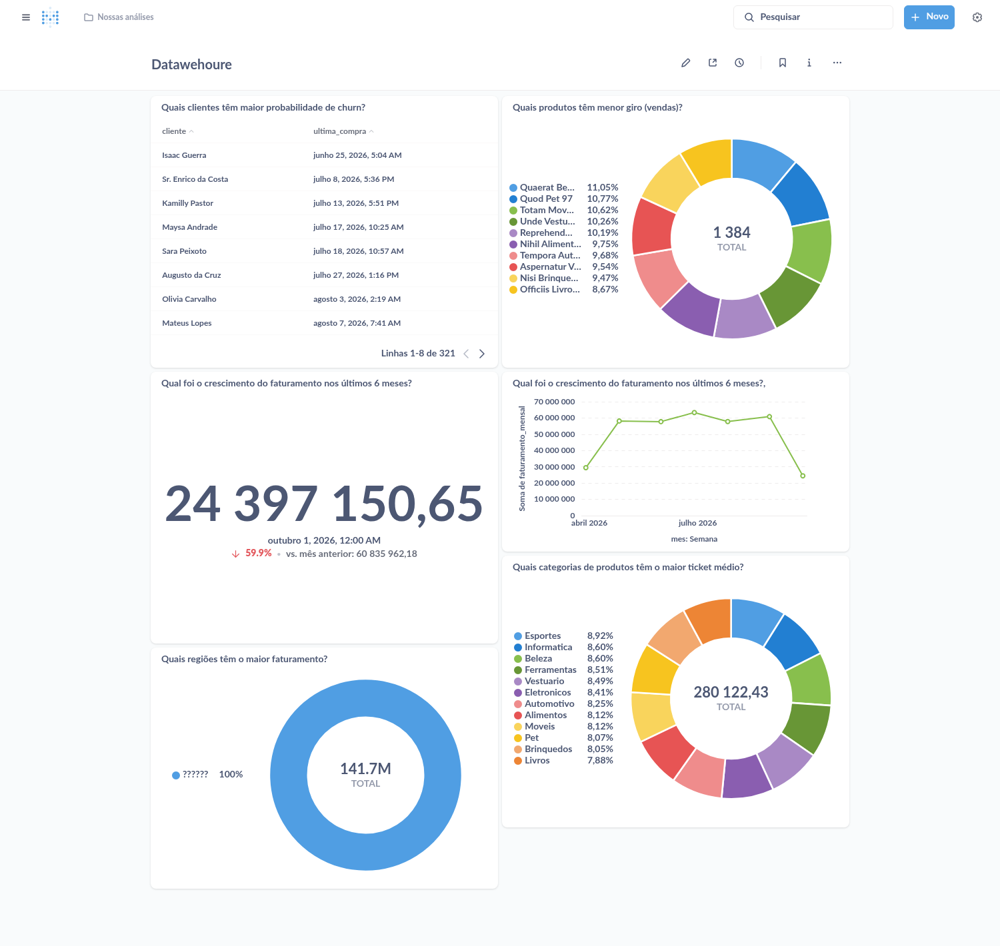

# 5️⃣ O DW de hoje — e onde ele mente

> ⬅️ Anterior: [4. Histórico e streaming](../../data_simulator/README.md) · [README principal](../../README.md) · Etapa 5 de 9

O transacional está pronto. Agora você muda de lado.

Nesta etapa você carrega o Data Warehouse **do jeito que a empresa faz hoje**
e olha os dashboards funcionando. Depois, com três consultas, descobre que
eles estão errados há muito tempo — e que o erro não é de SQL. É de
**modelagem**.

---

## 5.1 Por que existe um segundo banco?

A pergunta é justa: os dados já estão no transacional. Por que copiá-los?

Faça a experiência. A diretoria quer saber o **faturamento por categoria, por
mês**. No transacional (`make psql-oltp`):

<!-- rodar: oltp -->
```sql
SELECT c.descricao                           AS categoria,
       date_trunc('month', p.dt_venda)::date AS mes,
       sum(i.valor_total)                    AS faturamento
FROM pedidos p
JOIN itens_pedidos i ON i.id_pedido = p.id
JOIN produtos pr     ON pr.id = i.id_produto
JOIN categorias c    ON c.id = pr.id_categoria
GROUP BY 1, 2
ORDER BY 2, 1
LIMIT 4;
```

```
 categoria  |    mes     | faturamento
------------+------------+-------------
 Alimentos  | 2026-04-01 |   535039.20
 Automotivo | 2026-04-01 |   766784.51
 Beleza     | 2026-04-01 |   874232.22
 Brinquedos | 2026-04-01 |   640642.10
(4 rows)
```

Funciona. Mas repare no que foi preciso:

* **Quatro tabelas e três `JOIN`s** para uma pergunta simples. Quem escreve
  precisa saber que o valor está em `itens_pedidos`, que a categoria está a
  dois saltos de distância, e por onde passar para chegar lá.
* **Cada analista vai escrever de um jeito.** Um soma `pedidos.valor_total`,
  outro soma `itens_pedidos.valor_total`. Os dois acham que estão certos.
* **Essa consulta roda no banco que está vendendo.** Com milhões de pedidos,
  um relatório pesado deixa o site lento na hora do pico.

O transacional foi desenhado para **gravar um pedido de cada vez, sem
duplicar nada**. É para isso que servem as muitas tabelas pequenas. O
Data Warehouse é o mesmo dado redesenhado para a pergunta oposta: **ler
milhões de pedidos de uma vez, sem pensar em `JOIN`**.

| | Transacional (OLTP) | Dimensional (DW / OLAP) |
|---|---|---|
| Pergunta típica | "Grave este pedido" | "Quanto vendemos por categoria em 2026?" |
| Lê | uma linha | milhões de linhas |
| Desenho | muitas tabelas, normalizadas | poucas tabelas, desnormalizadas |
| Quem usa | o site, o app | analistas, dashboards, modelos |
| Prioridade | não errar na escrita | não complicar a leitura |

Saia do `psql` com `\q`.

---

## 5.2 Rode o ETL antigo

Quem leva o dado de um banco para o outro é o **ETL** (*Extract, Transform,
Load* — extrair, transformar, carregar). O da empresa está em
[`etl/legado/etl_legado.sql`](../../etl/legado/etl_legado.sql). Abra o arquivo
e leia: são três blocos, e ele está comentado.

<!-- rodar: shell -->
```bash
make etl-legado
```

```
--- prova: o DW esta lendo o transacional AO VIVO (nada foi copiado ainda)
 pessoas_no_oltp | pedidos_no_oltp |     venda_mais_recente
-----------------+-----------------+----------------------------
             501 |            5002 | 2026-10-13 18:27:43.877581
(1 row)


1) staging: copiando do transacional
TRUNCATE TABLE
INSERT 0 501
INSERT 0 200
INSERT 0 14981
2) dimensoes: dim_pessoas e dim_produtos
INSERT 0 501
INSERT 0 200
3) fato: fato_pedidos
INSERT 0 14981

--- o DW legado depois da carga
 dim_pessoas | dim_produtos | fato_pedidos
-------------+--------------+--------------
         501 |          200 |        14981
(1 row)
```

(Os seus números de pessoas e pedidos dependem de quantos o streaming gerou.
O que importa é que `fato_pedidos` tenha uma linha por **item** vendido.)

O que aconteceu, em três movimentos:

1. **Staging** — o dado foi copiado do transacional para as tabelas `stg_*`.
2. **Dimensões** — pessoas e produtos entraram em `dim_pessoas` e
   `dim_produtos`, cada um ganhando uma chave nova (`sk_`).
3. **Fato** — cada item de pedido virou uma linha de `fato_pedidos`, com os
   `id` do transacional **trocados** pelas `sk_` das dimensões.

> **Como o DW enxerga o outro banco?** São dois servidores PostgreSQL
> separados. A primeira parte da saída é o `postgres_fdw`, que faz as tabelas
> do transacional aparecerem dentro do DW, no schema `oltp`. Você vai ver isso
> em detalhe na etapa 7.

---

## 5.3 O DW funcionando

A mesma pergunta de antes, agora no DW (`make psql-dw`):

<!-- rodar: dw -->
```sql
SELECT d.cat_desc                            AS categoria,
       date_trunc('month', f.dt_venda)::date AS mes,
       sum(f.valor_unit)                     AS faturamento
FROM fato_pedidos f
JOIN dim_produtos d ON d.sk_produto = f.sk_produto
GROUP BY 1, 2
ORDER BY 2, 1
LIMIT 4;
```

```
 categoria  |    mes     | faturamento
------------+------------+-------------
 Alimentos  | 2026-04-01 |   535039.20
 Automotivo | 2026-04-01 |   766784.51
 Beleza     | 2026-04-01 |   874232.22
 Brinquedos | 2026-04-01 |   640642.10
(4 rows)
```

**Mesma resposta, um `JOIN` em vez de três.** A categoria já está dentro de
`dim_produtos`; a data e o valor já estão na fato. Esse é o ganho do modelo
dimensional, e ele é real.

Agora abra o Metabase (http://localhost:3020) → **Nossas análises** →
**Datawehoure**. O dashboard que estava vazio tem dados:



Parece ótimo. Vamos olhar de perto.

---

## 5.4 Os problemas escondidos

### Problema 1 — O faturamento está contado em dobro

No dashboard, o card **"Quais regiões têm o maior faturamento?"** mostra o
total faturado. Compare esse número com a verdade, que está no transacional:

<!-- rodar: dw -->
```sql
SELECT (SELECT sum(total) FROM fato_pedidos)       AS faturamento_no_dashboard,
       (SELECT sum(valor_total) FROM oltp.pedidos) AS faturamento_de_verdade,
       round((SELECT sum(total) FROM fato_pedidos)
             / (SELECT sum(valor_total) FROM oltp.pedidos), 2) AS vezes_maior;
```

```
 faturamento_no_dashboard | faturamento_de_verdade | vezes_maior
--------------------------+------------------------+-------------
             349255598.78 |            95229115.97 |        3.67
(1 row)
```

**O dashboard mostra quase quatro vezes o faturamento real.** A diretoria toma
decisões com esse número.

Para entender, olhe um pedido só:

<!-- rodar: dw -->
```sql
SELECT f.id_pedido, d.descricao AS produto, f.qtde, f.valor_unit, f.total
FROM fato_pedidos f
JOIN dim_produtos d ON d.sk_produto = f.sk_produto
WHERE f.id_pedido = 1
ORDER BY d.descricao;
```

```
 id_pedido |      produto       | qtde | valor_unit |  total
-----------+--------------------+------+------------+----------
         1 | Deserunt Movei 128 |    3 |    8935.89 | 10140.44
         1 | Totam Movei 24     |    1 |    1204.55 | 10140.44
(2 rows)
```

O pedido 1 tem dois itens e custou R$ 10.140,44. A fato tem **uma linha por
item** — mas a coluna `total` guarda o valor do **pedido inteiro**, repetido
em cada linha. Quem faz `SUM(total)` soma 10.140,44 duas vezes.

Isso tem nome. A fato tem um **grão** (o que uma linha representa) — aqui, o
item de pedido. Toda medida dentro da fato precisa estar **no mesmo grão**.
`total` está no grão do pedido, numa tabela que está no grão do item. A soma
mente, e mente mais quanto mais itens o pedido tem.

> **A regra que você leva daqui:** antes de criar uma fato, escreva em uma
> frase o que é uma linha dela. Depois, para cada medida, pergunte: "isto é
> desse mesmo grão?". Se não for, ela não pertence a essa tabela.

E há um segundo erro na mesma linha. A coluna se chama `valor_unit`, mas
8.935,89 dividido por 3 unidades dá 2.978,63: ela não é o valor unitário, é o
**total do item**. O nome engana. (Foi por isso que a consulta da seção 5.3
somou `valor_unit` e deu certo — quem escreveu sabia do truque.)

### Problema 2 — Uma mudança no produto duplica as vendas dele

Simule um reajuste de R$ 1,00 no produto 1. No **transacional**
(`make psql-oltp`):

<!-- rodar: oltp -->
```sql
UPDATE produtos SET valor_unit = valor_unit + 1 WHERE id = 1;
```

Rode o ETL antigo de novo:

<!-- rodar: shell -->
```bash
make etl-legado
```

```
--- prova: o DW esta lendo o transacional AO VIVO (nada foi copiado ainda)
 pessoas_no_oltp | pedidos_no_oltp |     venda_mais_recente
-----------------+-----------------+----------------------------
             501 |            5002 | 2026-10-13 18:27:43.877581
(1 row)


1) staging: copiando do transacional
TRUNCATE TABLE
INSERT 0 501
INSERT 0 200
INSERT 0 14981
2) dimensoes: dim_pessoas e dim_produtos
INSERT 0 0
INSERT 0 1
3) fato: fato_pedidos
INSERT 0 85

--- o DW legado depois da carga
 dim_pessoas | dim_produtos | fato_pedidos
-------------+--------------+--------------
         501 |          201 |        15066
(1 row)
```

Nenhum pedido novo entrou, mas a fato **cresceu 85 linhas**. Veja por quê, no
DW (`make psql-dw`):

<!-- rodar: dw -->
```sql
SELECT sk_produto, id, descricao, updated_at
FROM dim_produtos
WHERE id = 1
ORDER BY sk_produto;
```

```
 sk_produto | id |      descricao       |         updated_at
------------+----+----------------------+----------------------------
          1 |  1 | Tempore Automotivo 1 | 2026-10-13 18:27:59.22505
        201 |  1 | Tempore Automotivo 1 | 2026-10-13 18:28:00.122675
(2 rows)
```

O produto 1 agora tem **duas linhas** na dimensão. O ETL antigo percebeu que
o produto mudou e inseriu uma versão nova — o que seria uma boa ideia, se ele
soubesse **quando cada versão vale**. Ele não sabe. Então, na hora de carregar
a fato, cada venda do produto 1 casou com as duas versões:

<!-- rodar: dw -->
```sql
SELECT d.id AS produto,
       count(*)                    AS linhas_na_fato,
       count(DISTINCT f.id_pedido) AS pedidos_de_verdade
FROM fato_pedidos f
JOIN dim_produtos d ON d.sk_produto = f.sk_produto
WHERE d.id = 1
GROUP BY d.id;
```

```
 produto | linhas_na_fato | pedidos_de_verdade
---------+----------------+--------------------
       1 |            170 |                 85
(1 row)
```

O produto 1 foi vendido em 85 pedidos e aparece 170 vezes. **Um reajuste de
preço dobrou as vendas do produto no relatório.** Em produção, onde preços
mudam todo dia, esse DW infla sozinho.

A intenção era certa: guardar o histórico de uma dimensão é necessário, e tem
nome (*Slowly Changing Dimension*, SCD). O que faltou foi a **validade** de
cada versão. Você vai fazer isso direito na etapa 7.

### Problema 3 — A regra de negócio está escondida no dashboard

Volte ao Metabase e olhe o card **"Quais regiões têm o maior faturamento?"**.
A pizza tem uma fatia só, chamada `??????`.

A fato guarda o `geohash` cru, e quem descobria o estado era o próprio card,
com um `CASE` assim:

```sql
CASE WHEN geohash IN ('6gyf', '6gyc')         THEN 'SP'
     WHEN geohash IN ('7h2y', '7h2z', '7h2w') THEN 'MG'
     WHEN geohash IN ('75cm', '75cn')         THEN 'RJ'
     ELSE '??????'
END
```

Alguém escreveu a regra "qual geohash é qual estado" **dentro de um gráfico**.
Quando o formato do geohash mudou (hoje ele tem 7 caracteres), a regra parou
de funcionar e ninguém foi avisado: nenhum erro, só uma pizza inútil.

Regra de negócio dentro de dashboard é regra que ninguém mantém. O lugar dela
é o modelo: a UF precisa ser um **dado** do DW, não uma dedução do gráfico.

### Problema 4 — E as três demandas?

<!-- rodar: dw -->
```sql
\d fato_pedidos
```

```
                                          Table "public.fato_pedidos"
   Column    |            Type             | Collation | Nullable |                   Default
-------------+-----------------------------+-----------+----------+---------------------------------------------
 sk_id       | integer                     |           | not null | nextval('fato_pedidos_sk_id_seq'::regclass)
 id_pedido   | integer                     |           | not null |
 sk_pessoa   | bigint                      |           | not null |
 sk_produto  | integer                     |           | not null |
 dispositivo | character varying(50)       |           | not null |
 geohash     | character varying(50)       |           | not null |
 telefone    | character varying(20)       |           | not null |
 dt_venda    | timestamp without time zone |           | not null |
 qtde        | integer                     |           |          |
 valor_unit  | numeric(10,2)               |           |          |
 total       | numeric(10,2)               |           |          |
...
```

Você criou no transacional a fraude, o peso, o endereço, a transportadora, o
caminhão, o pagamento e o ciclo do pedido. **Nada disso chega ao DW.** O ETL
antigo nem sabe que essas tabelas existem.

Saia do `psql` com `\q`.

---

## 5.5 O diagnóstico

| # | Sintoma | Causa de modelagem |
|---|---|---|
| 1 | Faturamento 3,67× maior | Medida no grão errado (`total` do pedido numa fato de itens) |
| 1b | `valor_unit` não é unitário | Nome de coluna que não diz o que ela guarda |
| 2 | Vendas duplicam quando o produto muda | Histórico de dimensão sem data de validade |
| 3 | Pizza com fatia `??????` | Regra de negócio fora do modelo |
| 4 | Demandas sem resposta | O DW não acompanhou a evolução do transacional |

Nenhum desses se conserta com uma consulta melhor. Todos pedem **outro
desenho**. E repare numa coisa: dá para jogar o DW inteiro fora e reconstruir,
porque ele é **derivado** — a verdade está no transacional. É exatamente isso
que você vai fazer.

---

## ✅ Antes de seguir

* [ ] `make etl-legado` carregou `fato_pedidos` com uma linha por item
* [ ] Vi o dashboard **Datawehoure** com dados
* [ ] Reproduzi o faturamento em dobro e sei explicar o que é **grão**
* [ ] Reproduzi a duplicação do produto 1 depois do reajuste
* [ ] Sei por que a pizza de regiões mostra `??????`

---

# ➡️ Continue em [modelagem/05_evolucao_dw/README.md](../05_evolucao_dw/README.md)
